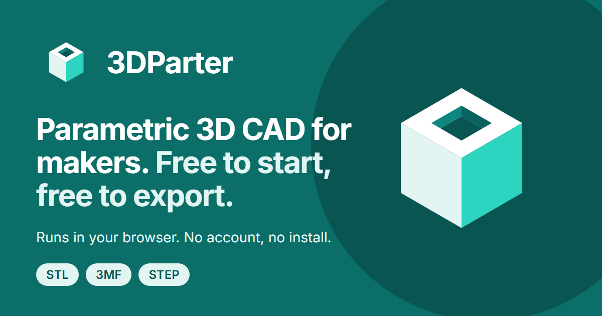
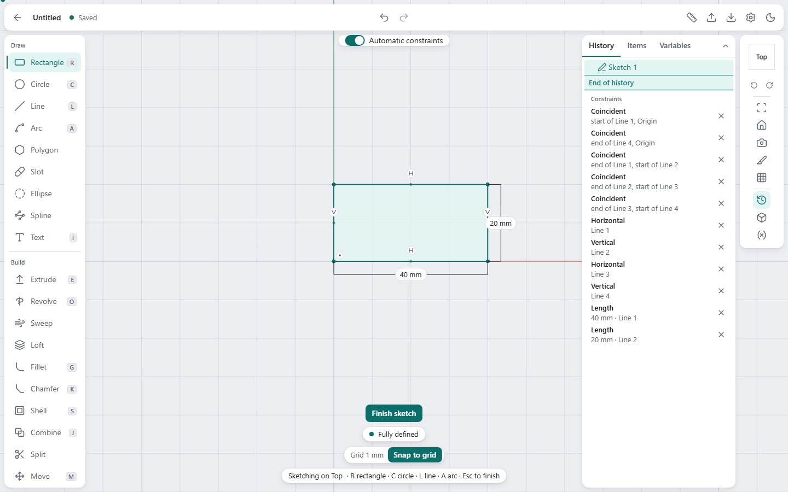
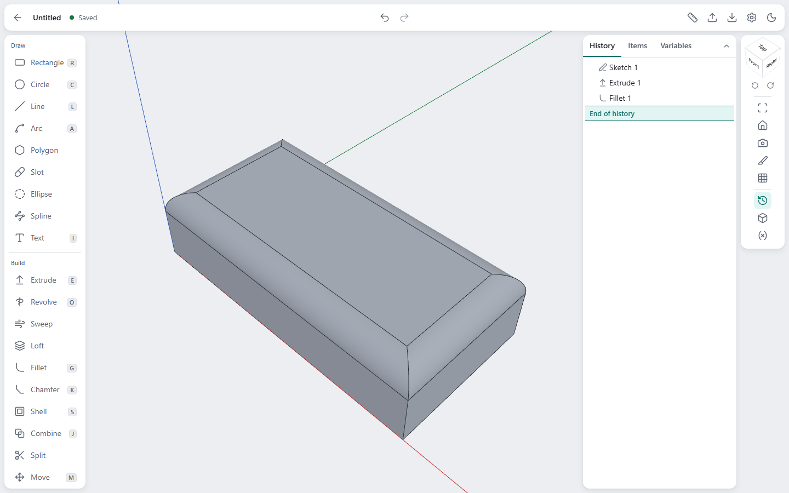
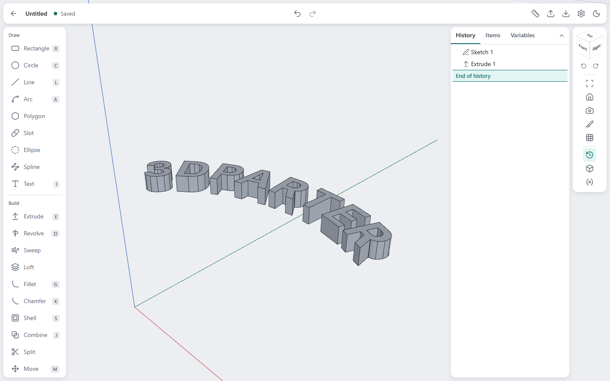
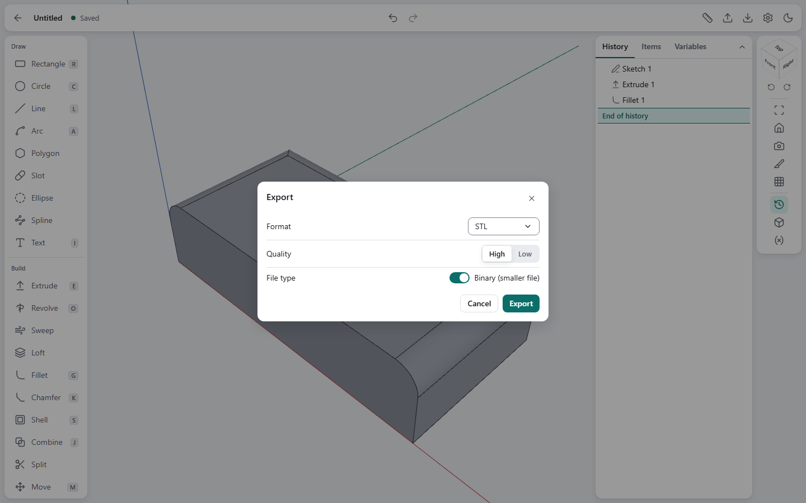
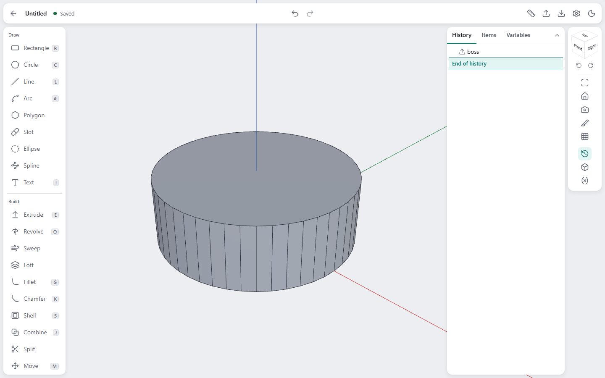
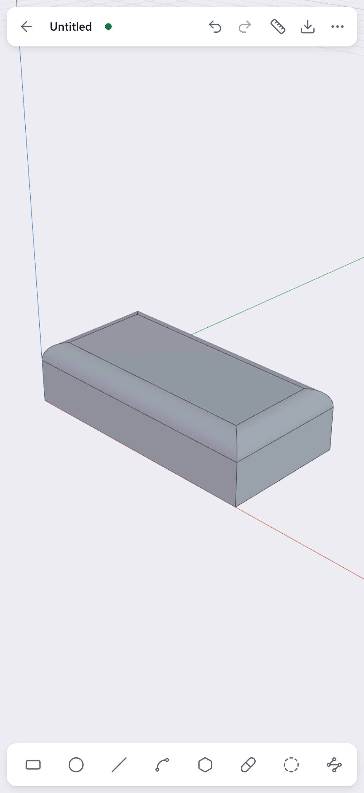

<p align="center">
  
</p>

<h1 align="center">3DParter™</h1>

<p align="center">
  <strong>Parametric 3D CAD for makers. Free to start, free to export.</strong><br>
  Sketch it, size it, print it. Right in your browser, no account, no install.
</p>

<p align="center">
  <a href="https://opivankristovi.github.io/3dparter/"><strong>▶ Open the app</strong></a>
  &nbsp;·&nbsp;
  <a href="https://opivankristovi.github.io/3dparter/#/welcome">What it is</a>
  &nbsp;·&nbsp;
  <a href="https://github.com/opivankristovi/3dparter/issues">Report a problem</a>
</p>

---

## Why

Hobby CAD usually comes with a business price tag, a sign-up wall before you can draw a rectangle, and a free tier that hands you blocky STL files. 3DParter takes the other road:

- **Open it and draw.** No account, no card, no tutorial gate. Your projects live in your browser.
- **Exports without a paywall.** STL at 0.01 mm detail, plus 3MF, STEP, OBJ and GLB.
- **Real parametric modelling.** Constrained sketches, a step history you can edit, variables in every number field.
- **Works offline.** After the first visit, the app opens and models without a connection. Install it like an app if you like.
- **Touch works too.** One finger orbits, two fingers pan and zoom. No stylus needed.

## A quick look

| Sketch with constraints | Fillet, chamfer, shell |
| --- | --- |
|  |  |
| **Text on a curve, raised or engraved** | **Export to STL, 3MF, STEP, OBJ or GLB** |
|  |  |
| **Import an STL and edit it as a solid** | **On a phone** |
|  |  |

## What you can do

**Sketch.** Rectangle, circle, line, arc, polygon, slot, ellipse, spline and text (straight or along a circle, arc or line). Coincident, parallel, tangent, equal, symmetric and the rest, plus dimensions you type as you draw. A plain-words status tells you how much can still move. Sketch on a plane or on any flat face.

**Build.** Extrude (new, join, cut, intersect, through all, with an offset), revolve, sweep, loft, fillet, chamfer, shell, combine, split, mirror, linear and circular pattern, move, rotate and scale.

**Change your mind.** Every step lands in the history. Edit an early one and the later steps rebuild; a step that breaks tells you why. Reorder steps, roll back, use variables and expressions like `width / 2 + 3` in any number field.

**Measure.** Length, angle, radius, area, volume and distances, with the units and precision you pick.

**Bring files in and out.** Import STEP, STL and 3MF. Meshes (closed, up to 20,000 triangles) become real solids you can cut, round and sketch on. Export STL, 3MF, STEP, OBJ and GLB, or the whole project as a `.3dparter.json` backup.

## Use it

1. Open **[opivankristovi.github.io/3dparter](https://opivankristovi.github.io/3dparter/)** and press **New project**.
2. Press **R**, click the ground plane, click a corner, type `40`, Tab, `20`, Enter.
3. **Finish sketch**, press **E**, type `10`, Enter. You have a box.
4. Press **G**, click an edge, type `2`, Enter. Rounded.
5. **Export**, pick **STL**, and print it.

Press **?** in the app for every keyboard shortcut, or **Ctrl+K** for the command palette.

> **Your data stays on your device.** Projects are stored in your browser. Clearing site data deletes them, so use **Export project** now and then for a backup. Details on the [privacy page](https://opivankristovi.github.io/3dparter/#/privacy).

## Run it yourself

You need [Node.js](https://nodejs.org/) 22 or newer.

```bash
git clone https://github.com/opivankristovi/3dparter.git
cd 3dparter/app
npm ci
npm run dev          # http://localhost:5173
```

| command (in `app/`) | what it does |
| --- | --- |
| `npm run dev` | dev server with hot reload |
| `npm test` | unit and kernel tests (Vitest) |
| `npx playwright install chromium` then `npm run e2e` | end-to-end tests, desktop and phone widths |
| `npm run build` | production build in `app/dist` (service worker included) |
| `npm run e2e:preview` | checks the production build: manifest, service worker, offline modelling |
| `npm run lint` | lint (oxlint) |

**Building for a sub-path** (like GitHub Pages): set `BASE_PATH=/3dparter/` and `SITE_URL=https://you.github.io/3dparter/` when you build. Leave them unset for a domain root. See `app/.env.example` for every build setting, including `VITE_SUPPORT_URL` for the "Report a problem" link.

**Deploys:** every push to `main` builds and publishes to GitHub Pages (`.github/workflows/pages.yml`). Firefox end-to-end tests run on demand (`.github/workflows/firefox.yml`).

## How it works

- **Geometry:** [OpenCascade](https://dev.opencascade.org/) compiled to WebAssembly, through [replicad](https://replicad.xyz/), in a Web Worker. The document is a list of steps; the solid is rebuilt by replaying them, and faces and edges keep stable names so later steps survive earlier edits.
- **Sketch solver:** [PlaneGCS](https://github.com/Salusoft89/planegcs) (WebAssembly).
- **UI:** React, TypeScript, Vite, three.js for the viewport, Tailwind with design tokens, Radix primitives.
- **Storage:** IndexedDB (Dexie), local first, with a two-tab guard and a service worker for offline use.
- **Tested** in Chromium, WebKit and Firefox with Playwright, plus axe accessibility scans.

## Status

**Beta.** Free while in beta. Known gaps: technical drawings, assemblies, rendering, and IGES, DXF or SVG import. Found a bug or missing something? [Open an issue](https://github.com/opivankristovi/3dparter/issues) or use **Report a problem** in the app, which fills one in for you (nothing is sent until you press the button).

[Terms](https://opivankristovi.github.io/3dparter/#/terms) · [Privacy](https://opivankristovi.github.io/3dparter/#/privacy)

## License

3DParter is free software: you can redistribute it and/or modify it under the terms of the **GNU General Public License** as published by the Free Software Foundation, either **version 3** of the License, or (at your option) any later version. It is distributed in the hope that it will be useful, but **without any warranty**; without even the implied warranty of merchantability or fitness for a particular purpose. See [LICENSE](LICENSE) for the full text.

Third-party libraries keep their own licenses: OpenCascade via replicad-opencascadejs (LGPL-2.1), PlaneGCS (LGPL-2.0 or later), the Inter font (SIL Open Font License 1.1), and MIT, ISC, Apache-2.0 or Unlicense for the rest.

The GPL covers the code, not the name: "3DParter" and the 3DParter logo are trademarks of the author and are not licensed under the GPL. If you ship a modified version, please give it a different name.
